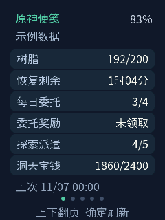
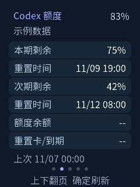
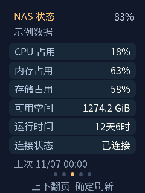
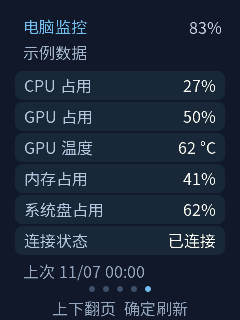

[简体中文](README.zh_CN.md) · **English**

# AI Passport Pocket Notes

**Source version: v0.1.0** · [Version file](VERSION) ·
[Known issues, fixes and validation](docs/development/pocket-notes-status.md)

A configurable, five-page pocket dashboard for FoloToy AI Passport: Genshin
daily notes, Codex usage allowances, QNAP NAS status, a Home Assistant remote
page and Windows PC monitoring. Extend the included source to make your own
pages.

Built on the complete [FoloToy AI Passport project](https://github.com/FoloToy/ai-passport)
([Gitee](https://gitee.com/FoloToy/ai-passport)). This is an independent derivative
application, with its own card UI and the upstream BSP retained. It is not an
official FoloToy, OpenAI, HoYoverse, QNAP or Xiaomi application.

## Features

| Page or setting | Capability and current scope |
| --- | --- |
| Genshin | Mainland China QR login and daily-note data; international HoYoLAB login is not implemented |
| Codex | Read-only allowance windows and reset times through the local desktop assistant; unavailable source fields stay unavailable |
| NAS | Read-only SNMPv2c CPU, memory, storage and uptime monitoring; configure your own NAS address/community |
| Home Assistant | Prepared REST-based device/action integration; requires a separate HA deployment and per-device testing |
| PC | 23 selectable Windows/NVIDIA metrics, automatically grouped into six-row subpages; unsupported sensors stay unavailable |
| Navigation | Reorder and enable/disable business pages from the phone settings page |
| Display | Phone and on-device brightness/idle-timeout settings, saved across restarts; automatic screen-off can be disabled |

## Core pages

<table>
  <tr><th>Genshin daily notes</th><th>Codex allowances</th></tr>
  <tr>
    <td></td>
    <td></td>
  </tr>
  <tr><th>NAS status</th><th>PC monitoring</th></tr>
  <tr>
    <td></td>
    <td></td>
  </tr>
</table>

Rendered from the actual LVGL application with synthetic example data, never
private account screenshots. Unsupported optional Codex balance/card fields
are shown as `--`. Reproduce the images with
`python docs/assets/render-core-pages.py --lvgl <lvgl-source> --zig <zig-executable>`.

## Hardware and build

- FoloToy AI Passport: **ESP32-C3, 8 MB Flash, no PSRAM**.
- ESP-IDF **5.5.3**, with dependencies declared in the repository and restored online.
- 240 × 320 display; existing board display, button and battery interfaces are reused.

```bash
git clone https://github.com/Lifezy/ai-passport-pocket-notes.git
cd ai-passport-pocket-notes
```

Read [AGENTS.md](AGENTS.md) and follow the
[environment setup](docs/development/engineering/environment-setup.md).
The five required AI skills are supplied under [skills/](skills/README.md).
With the matching IDF environment and host tools activated:

```bash
bash tools/validate.sh --static
node tests/test_pocket_setup_web.cjs
bash tools/validate.sh
```

The complete gate produces a verified merged image at
`build/FoloToy-AI-Passport-full.bin` for **offset 0x0**, plus matching debugging
artifacts under `build/firmware/<sha256>/`. For an already configured device,
check partition compatibility and use an application-only update when preserving
NVS. A merged flash can overwrite settings. See the
[flash/data policy](docs/development/engineering/firmware-layout.md).

## Use and configure

1. Hold DOWN to open phone setup and scan the QR shown on the device. Initial
   setup can create a password-protected device hotspot; follow the screen's
   connection instructions.
2. Configure your own Wi-Fi, NAS and optional services. Start the Windows helper
   with `Codex-Assistant.cmd` after installing its environment, or run
   `python tools/codex_assistant.py` with Windows Python 3.12 and tkinter.
3. Pair the desktop assistant through the phone settings page. Codex collection
   requires your own installed, signed-in Codex CLI/App Server and network access.
4. On a normal page overview, **double-click OK** for local screen settings.
   UP/DOWN selects; OK edits; UP/DOWN changes; OK saves; hold OK to cancel/back.
   Brightness is 10%–100%; idle timeout supports disabled/30/60/120/300 seconds.

Account credentials, Wi-Fi passwords and pairing state are not shipped in the
repository. The application does not encrypt its NVS storage. Keep the setup
page and authenticated helper service on a trusted local network.

See the [user guide](docs/development/pocket-notes.md) for page-specific setup.

## Make your own pages

Start with the [developer handoff](docs/development/pocket-notes-handoff.md),
[source map/page checklist](docs/development/pocket-notes-page-development.md)
and [implemented API contracts](docs/development/pocket-notes-protocol.md).

Pages are compiled into the firmware; there is no runtime HTML/plugin loader.
Keep stable page IDs and stored configuration compatible, use worker tasks for
network/storage, hold the BSP LVGL lock for UI access, and validate Chinese font
coverage. Add fixture data and host tests before relying on live services.

The upstream synchronization workflow is intentionally disabled for this
application repository; upstream changes require review before integration.

## Validation and limits

The previously delivered development image `58be2aca` passed build and host
checks. A user reported normal menu entry, brightness preview/save, cancellation
and disabled automatic screen-off after leaving the menu. This is limited
user-observed acceptance, not full hardware or endurance validation; newly built
images need their own device checks. Details are in the
[development log](docs/development/pocket-notes-development-log.md).

Left-side power-key short-press screen control is **not implemented**: the public
hardware/BSP definitions do not supply a readable side-key interface. Other
remaining checks include power-cycle persistence, actual current consumption,
long-running stability, HA deployment/device coverage, and non-NVIDIA GPU
sensors. Native Mi Home eight-key enrollment is not implemented; see the
[research notes](docs/development/mihome-eight-key-research.md).

## License and acknowledgements

Project code uses the [MIT License](LICENSE), retaining the original FoloToy
copyright notice. Thanks to the upstream project and contributors for the board
support, hardware documentation, examples, validation tools and workflow.

Source Han font assets retain their separate
[SIL Open Font License 1.1](assets/fonts/source-han/LICENSE.txt). Preserve the
licenses and notices supplied with all reused assets and dependencies.
