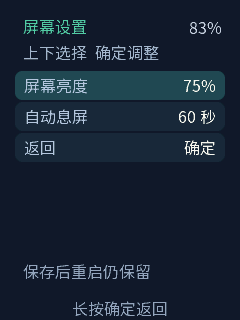
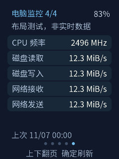

**简体中文** · [English](README.md)

# AI Passport 多页便笺

**源码版本：v0.1.0** · [版本文件](VERSION) ·
[已知问题、修复记录与验证范围](docs/development/pocket-notes-status.zh_CN.md)

面向 FoloToy AI Passport 的可配置五页随身面板：原神便笺、Codex 额度、威联通 NAS
状态、Home Assistant 遥控页与 Windows 电脑监控。可以基于完整源码开发自己的页面。

基于完整 [FoloToy AI Passport 项目](https://github.com/FoloToy/ai-passport)
（[Gitee](https://gitee.com/FoloToy/ai-passport)）开发，是保留上游 BSP、独立设计卡片界面的
派生应用。不是 FoloToy、OpenAI、米哈游、威联通或小米的官方应用。

## 功能

| 页面或设置 | 能力与当前范围 |
| --- | --- |
| 原神 | 国服扫码登录及便笺数据；尚未实现国际服 HoYoLAB 登录 |
| Codex | 通过本地电脑助手只读显示额度窗口与重置时间；数据源不支持的字段显示不可用 |
| NAS | 只读 SNMPv2c CPU、内存、存储、运行时长；自行设置 NAS 地址和团体名 |
| Home Assistant | 已准备基于 REST 的设备/动作接入；需另行部署 HA 并逐设备验证 |
| 电脑 | 23 项可选 Windows/NVIDIA 指标，每六项自动分成子页；缺少的传感器显示不可用 |
| 导航 | 手机设置页面顺序、启用或停用业务页 |
| 显示 | 手机与设备端设置亮度和闲置息屏时间，重启保留；可关闭自动息屏 |

<p>
  
  
</p>

以上是模拟数据的主机渲染示例，不是真实账号截图。

## 硬件与构建

- FoloToy AI Passport：**ESP32-C3、8 MB Flash、没有 PSRAM**。
- ESP-IDF **5.5.3**；依赖按仓库声明联网恢复。
- 240 × 320 屏幕，复用现有板级显示、按键及电量接口。

```bash
git clone https://github.com/Lifezy/ai-passport-pocket-notes.git
cd ai-passport-pocket-notes
```

先读 [AGENTS.md](AGENTS.md)，按[环境引导](docs/development/engineering/environment-setup.zh_CN.md)
准备工具。五个必需 AI Skill 位于 [skills/](skills/README.zh_CN.md)。激活匹配的 IDF
及主机工具后运行：

```bash
bash tools/validate.sh --static
node tests/test_pocket_setup_web.cjs
bash tools/validate.sh
```

完整门禁生成经过校验的 `build/FoloToy-AI-Passport-full.bin`，从 **0x0** 刷写；
匹配的调试归档位于 `build/firmware/<sha256>/`。已有配置的设备应先核对分区兼容，
需要保留 NVS 时采用仅应用更新；合并刷写可能覆盖设置。详见
[刷写及数据政策](docs/development/engineering/firmware-layout.zh_CN.md)。

## 使用与配置

1. 长按下键打开手机设置，扫描设备上的二维码。首次设置可创建带密码的设备热点，
   按设备屏幕提示连接。
2. 填写自己的 Wi-Fi、NAS 及可选服务信息。准备环境后，用 `Codex-Assistant.cmd`
   启动 Windows 助手，或使用带 tkinter 的 Windows Python 3.12 执行
   `python tools/codex_assistant.py`。
3. 在手机设置中配对电脑助手。Codex 采集需要自己的已安装并登录的 Codex CLI/App
   Server 及相应网络。
4. 普通业务页概览中**双击确定**打开本机屏幕设置。上下选择、确定编辑、上下调整、
   确定保存，长按确定取消或返回。亮度 10%–100%；息屏支持关闭、30/60/120/300 秒。

仓库不携带账号凭据、Wi-Fi 密码或配对状态。应用未加密 NVS 存储；设置页及带鉴权的
电脑助手服务应仅在可信局域网使用。各页配置详见
[使用指南](docs/development/pocket-notes.zh_CN.md)。

## 开发自己的页面

先读[开发者交接说明](docs/development/pocket-notes-handoff.zh_CN.md)、
[源码导览与页面清单](docs/development/pocket-notes-page-development.zh_CN.md)及
[已实现接口规范](docs/development/pocket-notes-protocol.zh_CN.md)。

页面编译进固件，没有运行时 HTML/插件加载器。保持页面 ID 和存储配置兼容，网络/
存储放入工作任务，访问界面持有 BSP LVGL 锁，并核对中文字体覆盖。先增加模拟数据
和主机测试，再接真实服务。

此应用仓库已停用上游自动同步工作流；合入上游更新前应审阅差异。

## 验证与边界

先前交付的开发固件 `58be2aca` 已通过构建及主机检查。用户确认菜单进入、亮度预览/
保存、取消，以及退出菜单后的不自动息屏正常。这是有限的用户观察验收，不等于完整
硬件或耐久性验证；新构建镜像仍需自身设备检查。详见
[开发记录](docs/development/pocket-notes-development-log.zh_CN.md)。

**尚未实现左侧电源键短按息屏/亮屏**：公开硬件与 BSP 定义没有提供可读侧键接口。
其他待验证项包括断电保留、实际电流、长时间稳定性、HA 部署与设备覆盖，以及非
NVIDIA GPU 传感器。原生米家八键设备注册也尚未实现，见
[调研记录](docs/development/mihome-eight-key-research.zh_CN.md)。

## 授权与致谢

项目代码采用 [MIT License](LICENSE)，保留 FoloToy 原版权声明。感谢上游项目及贡献者
提供的板级支持、硬件文档、示例、验证工具与工作流。

思源字体资源单独遵守 [SIL Open Font License 1.1](assets/fonts/source-han/LICENSE.txt)。
转发时请保留复用素材和依赖自带的授权及声明。
